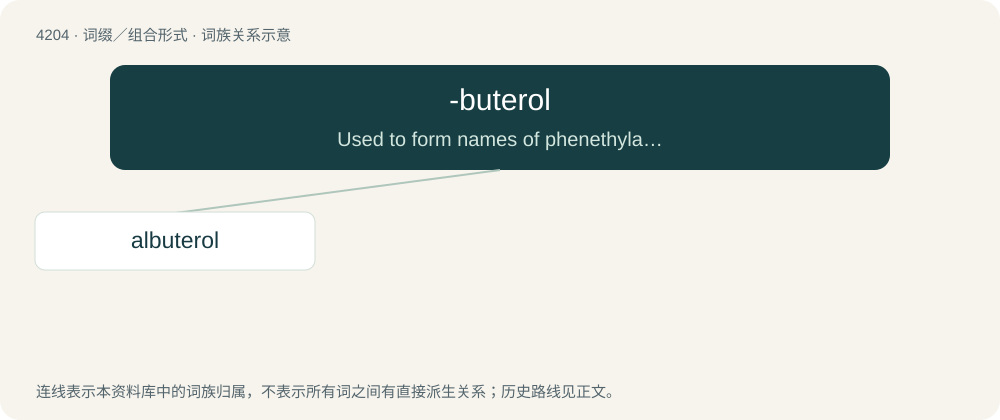

# 4212 · -buterol — Used to form names of phenethylamine derivatives used as bronchodilators.

[总目录](../00_总目录_按常用程度.md)

**类型**：词缀／组合形式　｜　**来源语言**：见词源记录

## 核心含义与来源

- 核心含义：Used to form names of phenethylamine derivatives used as bronchodilators.
- 英文含义：Used to form names of phenethylamine derivatives used as bronchodilators.
- 词形：-buterol

**来源记录 1**（后缀／后置成分；Used to form names of phenethylamine derivatives used as bronchodilators.）

From (tert-)but(yl) + -terol.

## 词族图

## 单词速览（常用到不常用）

| 单词 | 音标 | 释义 |
|---|---|---|
| [albuterol](#w-1) | 美 /ælˈbju.təˌɹɔl/ | \[化\] 沙丁胺醇; 舒喘宁 |

## 逐词详解

### 1. albuterol

**词性**：名词　｜　**音标**：美 /ælˈbju.təˌɹɔl/

**中文释义**：\[化\] 沙丁胺醇; 舒喘宁

**英文义项**：Synonym of salbutamol.

**构词拆分**：salicylic acid + -buterol

**词源与演化**：

From (s)al(icylic acid) + -buterol (“phenethylamine derivative”).
