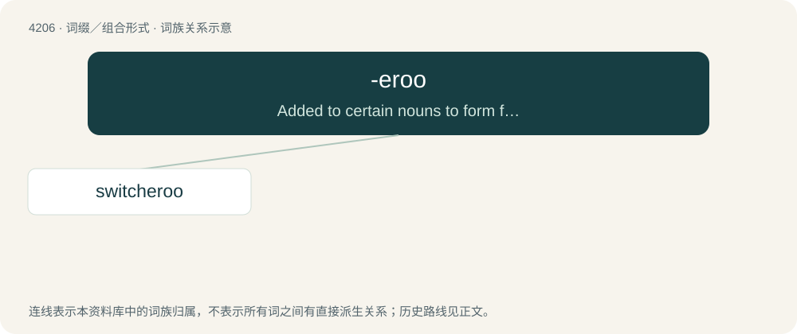

# 4214 · -eroo — Added to certain nouns to form familiar diminutives, normally with jocular or light-hearted intent.

[总目录](../00_总目录_按常用程度.md)

**类型**：词缀／组合形式　｜　**来源语言**：见词源记录

## 核心含义与来源

- 核心含义：Added to certain nouns to form familiar diminutives, normally with jocular or light-hearted intent.
- 英文含义：Added to certain nouns to form familiar diminutives, normally with jocular or light-hearted intent.
- 词形：-eroo

**来源记录 1**（后缀／后置成分；Added to certain nouns to form familiar diminutives, normally with jocular or light-hearted intent.）

Of unclear origin; perhaps extracted from buckaroo, though this word appears to have been conformed to a preexisting suffix (or word), the stress and final vowel being otherwise unaccounted for.

## 词族图

## 单词速览（常用到不常用）

| 单词 | 音标 | 释义 |
|---|---|---|
| [switcheroo](#w-1) | /ˌswɪt͡ʃəˈɹuː/ | n. 骤变, 惊人的大变 |

## 逐词详解

### 1. switcheroo

**词性**：名词　｜　**音标**：/ˌswɪt͡ʃəˈɹuː/

**中文释义**：n. 骤变, 惊人的大变

**英文义项**：A sneaky, unexpected, or clever swap or exchange.

**构词拆分**：From switch + -eroo.

**词源与演化**：

From switch + -eroo.
