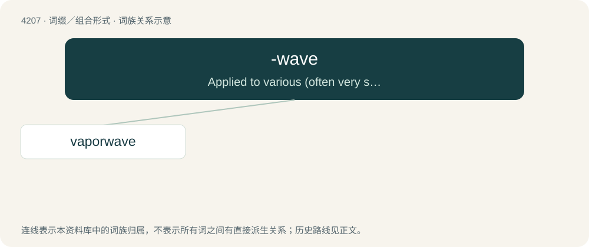

# 4215 · -wave — Applied to various (often very specialised) music genres, subcultures and aesthetics.

[总目录](../00_总目录_按常用程度.md)

**类型**：词缀／组合形式　｜　**来源语言**：见词源记录

## 核心含义与来源

- 核心含义：Applied to various (often very specialised) music genres, subcultures and aesthetics.
- 英文含义：Applied to various (often very specialised) music genres, subcultures and aesthetics.
- 词形：-wave

**来源记录 1**（后缀／后置成分；Applied to various (often very specialised) music genres, subcultures and aesthetics.）

Likely derived from new wave, and popularized by the terms chillwave and vaporwave.

## 词族图

## 单词速览（常用到不常用）

| 单词 | 音标 | 释义 |
|---|---|---|
| [vaporwave](#w-1) | 英 /ˈveɪ.pə.weɪv/；美 /ˈveɪ.pɚ.weɪv/ | 【英文】A genre of electronic music and visual arts style that emerged in the early 2010s. As a musical genre, it evolved from chillwave and seapunk with influences from lounge music, elevator music, smooth jazz, and 1980s d |

## 逐词详解

### 1. vaporwave

**词性**：名词　｜　**音标**：英 /ˈveɪ.pə.weɪv/；美 /ˈveɪ.pɚ.weɪv/

**英文义项**：A genre of electronic music and visual arts style that emerged in the early 2010s. As a musical genre, it evolved from chillwave and seapunk with influences from lounge music, elevator music, smooth jazz, and 1980s dance-pop. As an aesthetic, it is influenced by 1990s web design and digital art, anime, and cyberpunk.

**构词拆分**：vaporware + -wave

**词源与演化**：

From vapor(ware) + -wave.
