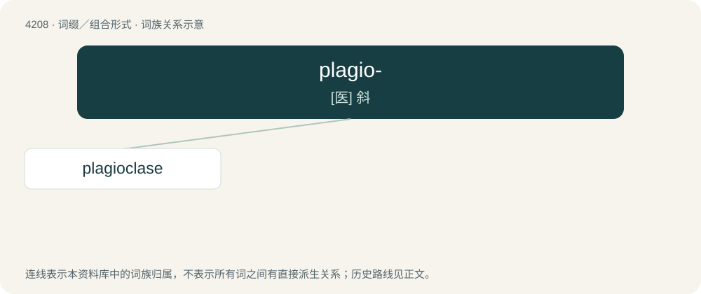

# 4216 · plagio- — \[医\] 斜

[总目录](../00_总目录_按常用程度.md)

**类型**：词缀／组合形式　｜　**来源语言**：见词源记录

## 核心含义与来源

- 核心含义：\[医\] 斜
- 英文含义：Slanted, oblique.
- 词形：plagio-

**来源记录 1**（前缀／前置成分；Slanted, oblique.）

From Late Latin plagio-, from Ancient Greek πλάγιος (plágios, “oblique”).

## 词族图

## 单词速览（常用到不常用）

| 单词 | 音标 | 释义 |
|---|---|---|
| [plagioclase](#w-1) | 英 /ˈpleɪ.d͡ʒɪ.əˌkleɪz/；美 /ˈpleɪ.d͡ʒi.əˌkleɪs/ | n. 斜长岩；\[化\] 斜长石 |

## 逐词详解

### 1. plagioclase

**词性**：名词　｜　**音标**：英 /ˈpleɪ.d͡ʒɪ.əˌkleɪz/；美 /ˈpleɪ.d͡ʒi.əˌkleɪs/

**中文释义**：n. 斜长岩；\[化\] 斜长石

**英文义项**：Any of a group of aluminum silicate feldspathic minerals ranging in their ratio of calcium to sodium.

**构词拆分**：plagio- + -clase

**词源与演化**：

From plagio- + -clase, after German Plagioklas.
