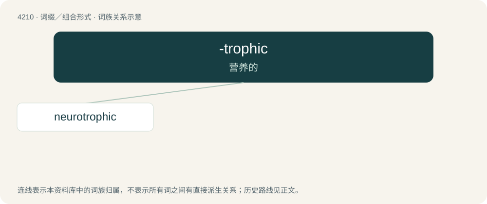

# 4218 · -trophic — 营养的

[总目录](../00_总目录_按常用程度.md)

**类型**：词缀／组合形式　｜　**来源语言**：见词源记录

## 核心含义与来源

- 核心含义：营养的
- 英文含义：Used to form adjectives corresponding to nouns ending in -trophy
- 词形：-trophic

**来源记录 1**（后缀／后置成分；Used to form adjectives corresponding to nouns ending in -trophy）

From Ancient Greek τροφικός (trophikós, “pertaining to food or nourishment”), from τροφή (trophḗ, “food”).

## 词族图

## 单词速览（常用到不常用）

| 单词 | 音标 | 释义 |
|---|---|---|
| [neurotrophic](#w-1) | /,njjərəjˈtrɔfik/ | a. 神经营养的,\[解\]向神经的,亲神经的 |

## 逐词详解

### 1. neurotrophic

**词性**：形容词　｜　**音标**：/,njjərəjˈtrɔfik/

**中文释义**：a. 神经营养的,\[解\]向神经的,亲神经的

**英文义项**：Of or relating to neurotrophy.

**构词拆分**：neuro- + -trophic

**词源与演化**：

From neuro- + -trophic.
