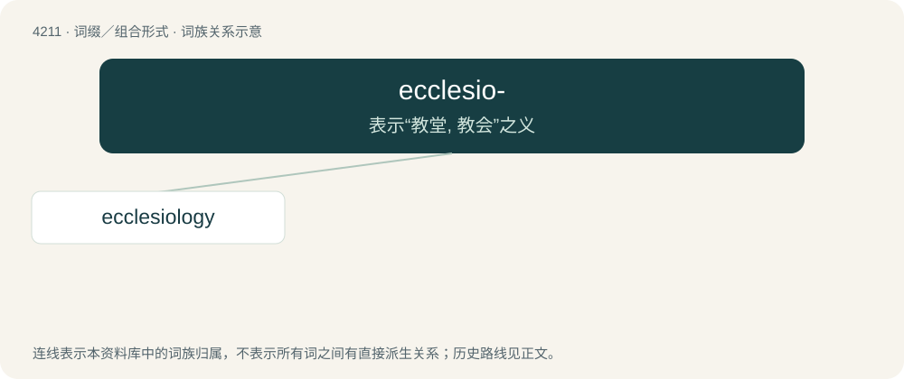

# 4219 · ecclesio- — 表示“教堂, 教会”之义

[总目录](../00_总目录_按常用程度.md)

**类型**：词缀／组合形式　｜　**来源语言**：见词源记录

## 核心含义与来源

- 核心含义：表示“教堂, 教会”之义
- 英文含义：church
- 词形：ecclesio-

**来源记录 1**（前缀／前置成分；church）

From Latin ecclēsia, from Ancient Greek ἐκκλησία (ekklēsía), + -o-.

## 词族图

## 单词速览（常用到不常用）

| 单词 | 音标 | 释义 |
|---|---|---|
| [ecclesiology](#w-1) | /ɪˌkliːziˈɒlədʒi/ | n. 教会学, 教会建筑学 |

## 逐词详解

### 1. ecclesiology

**词性**：名词　｜　**音标**：/ɪˌkliːziˈɒlədʒi/

**中文释义**：n. 教会学, 教会建筑学

**英文义项**：The branch of theology concerned with the doctrines, role etc. of a church. / The science of building and decorating churches.

**构词拆分**：ecclesio- + -logy

**词源与演化**：

From ecclesio- + -logy. Coined by a writer of the British Critic in 1837, as ecclesialogy.
