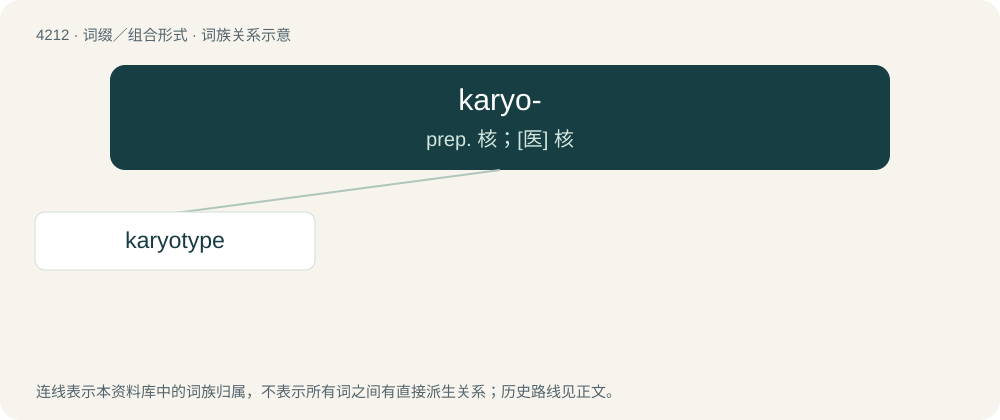

# 4220 · karyo- — prep. 核；\[医\] 核

[总目录](../00_总目录_按常用程度.md)

**类型**：词缀／组合形式　｜　**来源语言**：见词源记录

## 核心含义与来源

- 核心含义：prep. 核；\[医\] 核
- 英文含义：relating to the nucleus of cells
- 词形：karyo-

**来源记录 1**（前缀／前置成分；relating to the nucleus of cells）

From Ancient Greek κάρυον (káruon, “kernel”).

## 词族图

## 单词速览（常用到不常用）

| 单词 | 音标 | 释义 |
|---|---|---|
| [karyotype](#w-1) | 英 /ˈkaɹɪə(ʊ)taɪp/ | n. \[生物\] 染色体组型 |

## 逐词详解

### 1. karyotype

**词性**：名词　｜　**音标**：英 /ˈkaɹɪə(ʊ)taɪp/

**中文释义**：n. \[生物\] 染色体组型

**英文义项**：The observed characteristics (number, type, shape, etc) of the chromosomes of an individual or species. / A record of such characteristics, usually photographic.

**构词拆分**：karyo- + -type

**词源与演化**：

Borrowed from Russian кариотип (kariotip), equivalent to karyo- + -type.

**例句**：

> A karyotype may be used to look for abnormalities in chromosome number or structure.
