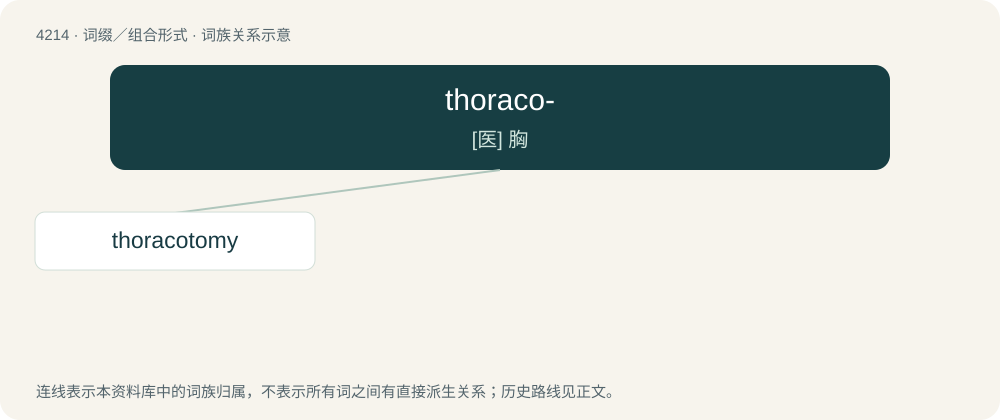

# 4222 · thoraco- — \[医\] 胸

[总目录](../00_总目录_按常用程度.md)

**类型**：词缀／组合形式　｜　**来源语言**：见词源记录

## 核心含义与来源

- 核心含义：\[医\] 胸
- 英文含义：thorax
- 词形：thoraco-

## 词族图

## 单词速览（常用到不常用）

| 单词 | 音标 | 释义 |
|---|---|---|
| [thoracotomy](#w-1) | /,θɔːrəˈkɔtəmi/ | \[医\] 胸廓切开术 |

## 逐词详解

### 1. thoracotomy

**词性**：名词　｜　**音标**：/,θɔːrəˈkɔtəmi/

**中文释义**：\[医\] 胸廓切开术

**英文义项**：The surgical procedure of making an incision into the chest, normally as a first step to gain access to the thoracic organs, such as the heart, the lungs, and the esophagus.

**构词拆分**：thoraco- + -tomy

**词源与演化**：

From thoraco- + -tomy.
