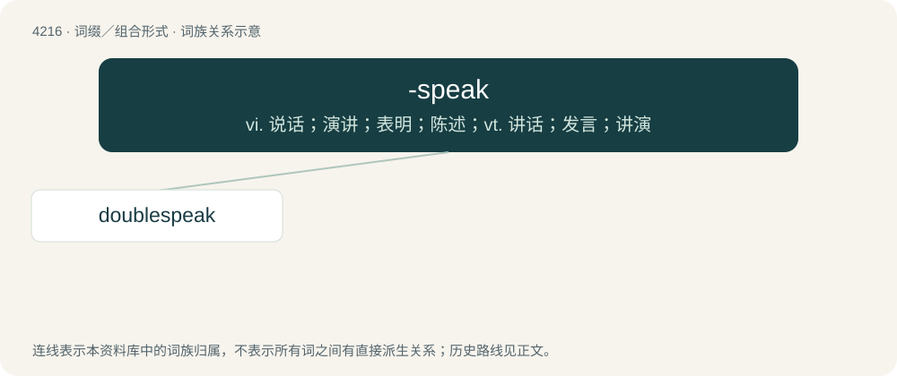

# 4223 · -speak — vi. 说话；演讲；表明；陈述；vt. 讲话；发言；讲演

[总目录](../00_总目录_按常用程度.md)

**类型**：词缀／组合形式　｜　**来源语言**：见词源记录

## 核心含义与来源

- 核心含义：vi. 说话；演讲；表明；陈述；vt. 讲话；发言；讲演
- 英文含义：Indicates a manner of speech or writing typical of or characterized by the root term.
- 词形：-speak

**来源记录 1**（后缀／后置成分；Indicates a manner of speech or writing typical of or characterized by the root term.）

Probably originally from Newspeak, coined by George Orwell in his book Nineteen Eighty-Four.

## 词族图

## 单词速览（常用到不常用）

| 单词 | 音标 | 释义 |
|---|---|---|
| [doublespeak](#w-1) | /ˈdəbəlˌspiːk/ | n. 欺人之谈, 故弄玄虚的言词 |

## 逐词详解

### 1. doublespeak

**词性**：名词　｜　**音标**：/ˈdəbəlˌspiːk/

**中文释义**：n. 欺人之谈, 故弄玄虚的言词

**英文义项**：Any language deliberately constructed to disguise or distort its actual meaning, often by employing euphemism or ambiguity.

**构词拆分**：double + -speak

**词源与演化**：

From double + -speak. Coined in the 1950s in the vein of George Orwell's Newspeak as used in his book Nineteen Eighty-Four. The word doublespeak does not appear in the book, although newspeak, oldspeak, and doublethink do.

**例句**：

> The report was riddled with so much corporate doublespeak that it was impossible to interpret.

该用例对应义项：Any language deliberately constructed to disguise or distort its actual meaning, often by employing euphemism or ambiguity.
