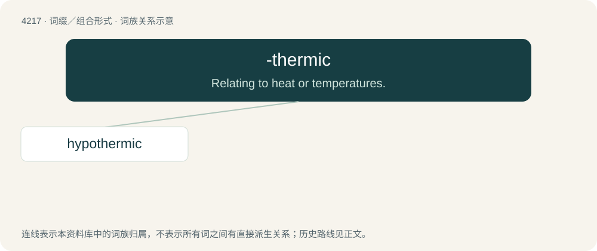

# 4224 · -thermic — Relating to heat or temperatures.

[总目录](../00_总目录_按常用程度.md)

**类型**：词缀／组合形式　｜　**来源语言**：见词源记录

## 核心含义与来源

- 核心含义：Relating to heat or temperatures.
- 英文含义：Relating to heat or temperatures.
- 词形：-thermic

**来源记录 1**（后缀／后置成分；Relating to heat or temperatures.）

Mid 19th century, from Ancient Greek θερμός (thermós, “heat”) + -ic.

## 词族图

## 单词速览（常用到不常用）

| 单词 | 音标 | 释义 |
|---|---|---|
| [hypothermic](#w-1) | /,haipəjˈθ\\\\ːmik/ | a. 低体温的, 体温过低的 |

## 逐词详解

### 1. hypothermic

**词性**：形容词　｜　**音标**：/,haipəjˈθ\\\\ːmik/

**中文释义**：a. 低体温的, 体温过低的

**英文义项**：Affected by hypothermia; having an abnormally low body temperature.

**构词拆分**：hypo- + -thermic

**词源与演化**：

From hypo- + -thermic.

**例句**：

> The survivors of the shipwreck quickly became hypothermic.

该用例对应义项：Affected by hypothermia; having an abnormally low body temperature.
