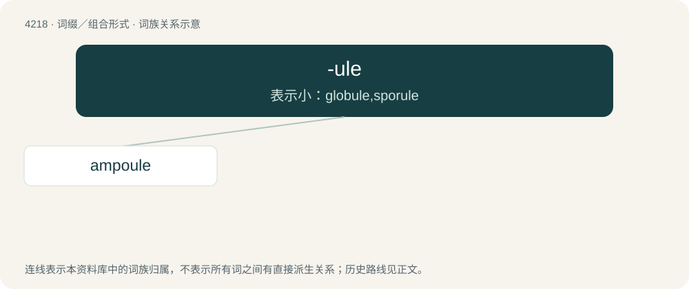

# 4225 · -ule — 表示小：globule,sporule

[总目录](../00_总目录_按常用程度.md)

**类型**：词缀／组合形式　｜　**来源语言**：见词源记录

## 核心含义与来源

- 核心含义：表示小：globule,sporule
- 英文含义：Diminutive suffix.
- 词形：-ule

**来源记录 1**（后缀／后置成分；Diminutive suffix.）

Derived from Latin -ula and French -ule.

## 词族图

## 单词速览（常用到不常用）

| 单词 | 音标 | 释义 |
|---|---|---|
| [ampoule](#w-1) | /ˈæm.puːl/ | n. 安瓿；\[化\] 安瓿; 针药管; 安瓿剂; 针药; 壶腹 |

## 逐词详解

### 1. ampoule

**词性**：名词　｜　**音标**：/ˈæm.puːl/

**中文释义**：n. 安瓿；\[化\] 安瓿; 针药管; 安瓿剂; 针药; 壶腹

**英文义项**：A small hermetically sealed vial, often used to contain a sterile solution suitable for injection.

**构词拆分**：amphora + -ule

**词源与演化**：

Borrowed from French ampoule. Etymologically equivalent to amphora + -ule/-le. Doublet of ampulla.
