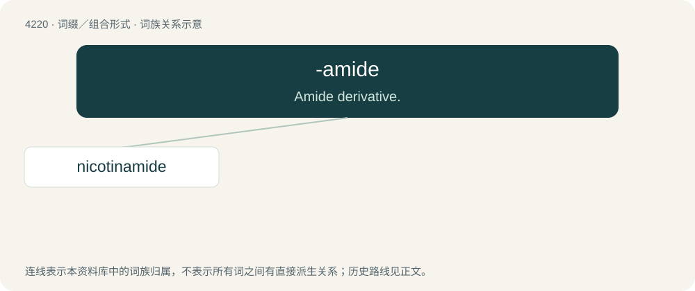

# 4227 · -amide — Amide derivative.

[总目录](../00_总目录_按常用程度.md)

**类型**：词缀／组合形式　｜　**来源语言**：见词源记录

## 核心含义与来源

- 核心含义：Amide derivative.
- 英文含义：Amide derivative.
- 词形：-amide

**来源记录 1**（后缀／后置成分；Amide derivative.）

From amide.

## 词族图

## 单词速览（常用到不常用）

| 单词 | 音标 | 释义 |
|---|---|---|
| [nicotinamide](#w-1) | /.nikəˈtinəmaid/ | n. 烟酰胺；\[化\] 烟酰胺; 尼克酰胺; 抗糙皮病维生素; 维生素PP |

## 逐词详解

### 1. nicotinamide

**词性**：名词　｜　**音标**：/.nikəˈtinəmaid/

**中文释义**：n. 烟酰胺；\[化\] 烟酰胺; 尼克酰胺; 抗糙皮病维生素; 维生素PP

**英文义项**：The amide of nicotinic acid (or niacin).

**构词拆分**：nicotine + -amide

**词源与演化**：

Blend of nicotine + amide, equivalent to nicotine + -amide.
