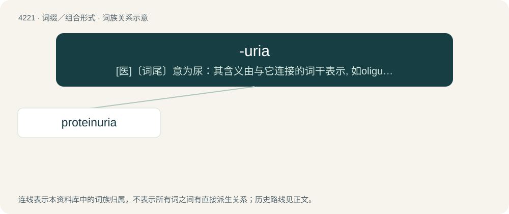

# 4228 · -uria — \[医\]〔词尾〕意为尿：其含义由与它连接的词干表示, 如oliguria（少尿）, proteinuria（蛋白尿）等

[总目录](../00_总目录_按常用程度.md)

**类型**：词缀／组合形式　｜　**来源语言**：见词源记录

## 核心含义与来源

- 核心含义：\[医\]〔词尾〕意为尿：其含义由与它连接的词干表示, 如oliguria（少尿）, proteinuria（蛋白尿）等
- 英文含义：urine; urination; presence in urine (of a substance denoted by a prefixed combining form); state or condition of the urine.
- 词形：-uria

**来源记录 1**（后缀／后置成分；urine; urination; presence in urine (of a substance denoted by a prefixed combining form); state or condition of the urine.）

From international scientific vocabulary, reflecting a New Latin combining form, Latin -ūria, from Ancient Greek -ουρία (-ouría), from οὖρον (oûron, “urine”).

## 词族图

## 单词速览（常用到不常用）

| 单词 | 音标 | 释义 |
|---|---|---|
| [proteinuria](#w-1) | 美 /ˌpɹoʊtiːnˈjʊɹiə/ | n. 蛋白尿；\[化\] 蛋白尿 |

## 逐词详解

### 1. proteinuria

**词性**：名词　｜　**音标**：美 /ˌpɹoʊtiːnˈjʊɹiə/

**中文释义**：n. 蛋白尿；\[化\] 蛋白尿

**英文义项**：The presence of protein in the urine (which is always true in small amounts); and usually, more specifically, an excess (hyperproteinuria).

**构词拆分**：protein + -uria

**词源与演化**：

From protein + -uria.
