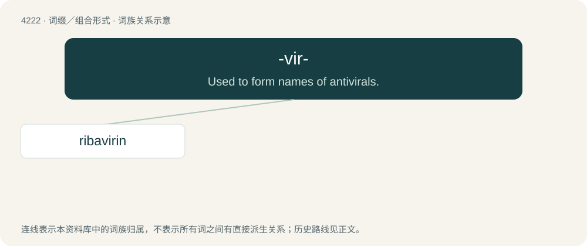

# 4229 · -vir- — Used to form names of antivirals.

[总目录](../00_总目录_按常用程度.md)

**类型**：词缀／组合形式　｜　**来源语言**：见词源记录

## 核心含义与来源

- 核心含义：Used to form names of antivirals.
- 英文含义：Used to form names of antivirals.
- 词形：-vir-

**来源记录 1**（interfix；Used to form names of antivirals.）

From virus.

## 词族图

## 单词速览（常用到不常用）

| 单词 | 音标 | 释义 |
|---|---|---|
| [ribavirin](#w-1) | /ˌɹaɪ.bəˈvaɪ.ɹɪn/ | \[化\] 利巴韦林; 三氮唑核苷 |

## 逐词详解

### 1. ribavirin

**词性**：名词　｜　**音标**：/ˌɹaɪ.bəˈvaɪ.ɹɪn/

**中文释义**：\[化\] 利巴韦林; 三氮唑核苷

**英文义项**：A synthetic analog of guanosine with chemical formula C₈H₁₂N₄O₅ that inhibits viral nucleic acid synthesis and is used as a broad-spectrum antiviral drug especially in the treatment of respiratory syncytial virus infection and chronic hepatitis C.

**构词拆分**：riboside + -a- + -vir- + -in

**词源与演化**：

From rib(oside) + -a- + -vir- (“antiviral”) + -in.
