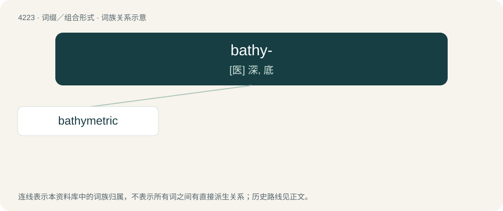

# 4230 · bathy- — \[医\] 深, 底

[总目录](../00_总目录_按常用程度.md)

**类型**：词缀／组合形式　｜　**来源语言**：见词源记录

## 核心含义与来源

- 核心含义：\[医\] 深, 底
- 英文含义：deep, especially deep sea
- 词形：bathy-

**来源记录 1**（前缀／前置成分；deep, especially deep sea）

Borrowed from Ancient Greek βαθύς (bathús, “deep”).

## 词族图

## 单词速览（常用到不常用）

| 单词 | 音标 | 释义 |
|---|---|---|
| [bathymetric](#w-1) | /,bæθiˈmetrik/ | a. 深测法的 |

## 逐词详解

### 1. bathymetric

**词性**：形容词　｜　**音标**：/,bæθiˈmetrik/

**中文释义**：a. 深测法的

**英文义项**：Of, pertaining to, or derived from bathymetry.

**构词拆分**：bathy- + -metric

**词源与演化**：

From bathy- + -metric.
