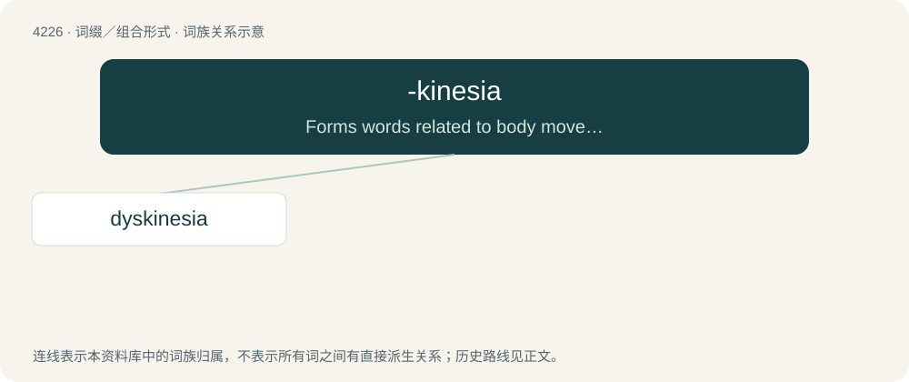

# 4233 · -kinesia — Forms words related to body movement, often pathological, sometimes synonymous to words ending in -kinesis.

[总目录](../00_总目录_按常用程度.md)

**类型**：词缀／组合形式　｜　**来源语言**：见词源记录

## 核心含义与来源

- 核心含义：Forms words related to body movement, often pathological, sometimes synonymous to words ending in -kinesis.
- 英文含义：Forms words related to body movement, often pathological, sometimes synonymous to words ending in -kinesis.
- 词形：-kinesia

**来源记录 1**（后缀／后置成分；Forms words related to body movement, often pathological, sometimes synonymous to words ending in -kinesis.）

From Ancient Greek κίνησις (kínēsis, “motion”). Compare kinesia (sense 2).

## 词族图

## 单词速览（常用到不常用）

| 单词 | 音标 | 释义 |
|---|---|---|
| [dyskinesia](#w-1) | 美 /dɪs.kəˈniʒə/ | n. 运动障碍, 动作困难；\[医\] 运动障碍 |

## 逐词详解

### 1. dyskinesia

**词性**：名词　｜　**音标**：美 /dɪs.kəˈniʒə/

**中文释义**：n. 运动障碍, 动作困难；\[医\] 运动障碍

**英文义项**：A state of involuntary muscle movements, like tics and torticollis, and reduced voluntary muscle movements. / A disorder involving such state.

**构词拆分**：dys- + -kinesia

**词源与演化**：

From dys- + -kinesia.
