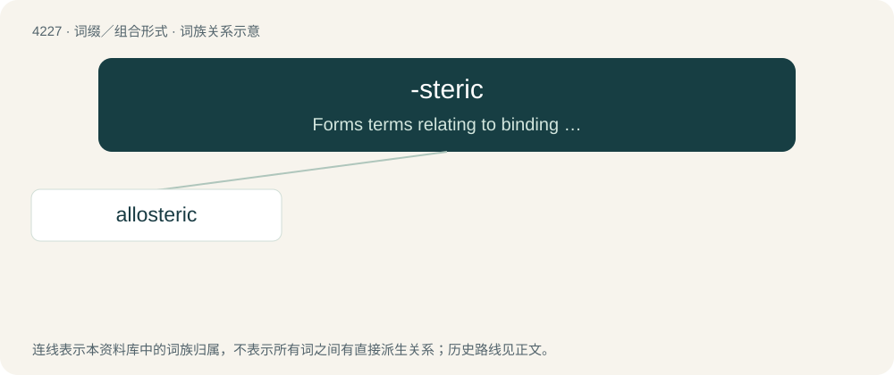

# 4234 · -steric — Forms terms relating to binding behaviors towards enzymes and receptors. See Allostery.

[总目录](../00_总目录_按常用程度.md)

**类型**：词缀／组合形式　｜　**来源语言**：见词源记录

## 核心含义与来源

- 核心含义：Forms terms relating to binding behaviors towards enzymes and receptors. See Allostery.
- 英文含义：Forms terms relating to binding behaviors towards enzymes and receptors. See Allostery.
- 词形：-steric

**来源记录 1**（后缀／后置成分；Forms terms relating to binding behaviors towards enzymes and receptors. See Allostery.）

From Ancient Greek στερεός (stereós, “solid, three-dimensional”) + -ic. The principal derivations are allosteric and orthosteric.

## 词族图

## 单词速览（常用到不常用）

| 单词 | 音标 | 释义 |
|---|---|---|
| [allosteric](#w-1) | /,æləˈsterik/ | a. \[生化\]变构(象)的 |

## 逐词详解

### 1. allosteric

**词性**：形容词　｜　**音标**：/,æləˈsterik/

**中文释义**：a. \[生化\]变构(象)的

**英文义项**：That binds a compound on an inactive site and thus changes macromolecular conformation or dynamics in order to become either active or inactive

**构词拆分**：allo- (“other”) + -steric

**词源与演化**：

From allo- (“other”) + -steric.
