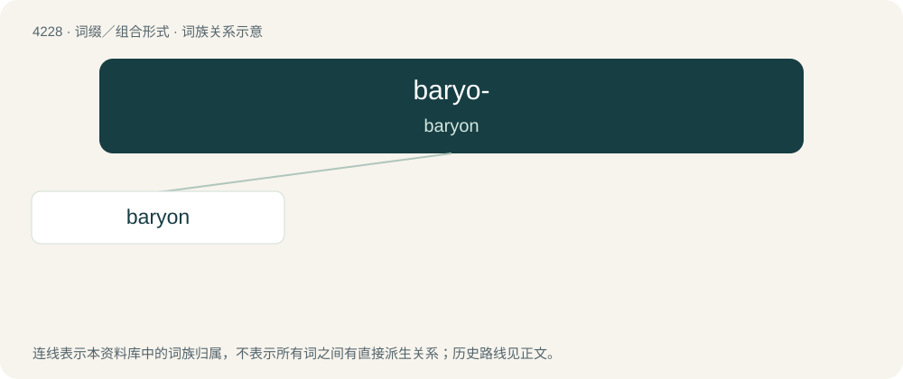

# 4235 · baryo- — baryon

[总目录](../00_总目录_按常用程度.md)

**类型**：词缀／组合形式　｜　**来源语言**：见词源记录

## 核心含义与来源

- 核心含义：baryon
- 英文含义：baryon
- 词形：baryo-

**来源记录 1**（前缀／前置成分；baryon）

Clipping of baryon. From Ancient Greek βαρύς (barús, “heavy”).

## 词族图

## 单词速览（常用到不常用）

| 单词 | 音标 | 释义 |
|---|---|---|
| [baryon](#w-1) | /ˈbɛəɹiɒn/ | n. 重子；\[化\] 重子 |

## 逐词详解

### 1. baryon

**词性**：名词　｜　**音标**：/ˈbɛəɹiɒn/

**中文释义**：n. 重子；\[化\] 重子

**英文义项**：A heavy subatomic particle created by the binding of quarks by gluons; a hadron containing three quarks. Baryons have half-odd integral spin and are thus fermions. This category includes the common proton and neutron of the atomic nucleus.

**构词拆分**：baryo- + -on

**词源与演化**：

From Ancient Greek βαρύς (barús, “heavy”) + English -on. Coined by Dutch-American physicist Abraham Pais in 1953. Equivalent to baryo- + -on.
