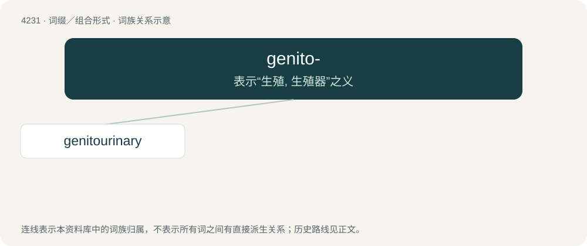

# 4238 · genito- — 表示“生殖, 生殖器”之义

[总目录](../00_总目录_按常用程度.md)

**类型**：词缀／组合形式　｜　**来源语言**：见词源记录

## 核心含义与来源

- 核心含义：表示“生殖, 生殖器”之义
- 英文含义：Relating to the genitals.
- 词形：genito-

## 词族图

## 单词速览（常用到不常用）

| 单词 | 音标 | 释义 |
|---|---|---|
| [genitourinary](#w-1) | /,dʒenitəuˈjuərinəri/ | a. 泌尿生殖器的；\[医\] 泌尿生殖的 |

## 逐词详解

### 1. genitourinary

**词性**：形容词　｜　**音标**：/,dʒenitəuˈjuərinəri/

**中文释义**：a. 泌尿生殖器的；\[医\] 泌尿生殖的

**英文义项**：Of or pertaining to the genital and urinary systems of the body, together with their function, disease, etc.

**构词拆分**：From genito- + urinary.

**词源与演化**：

From genito- + urinary.
