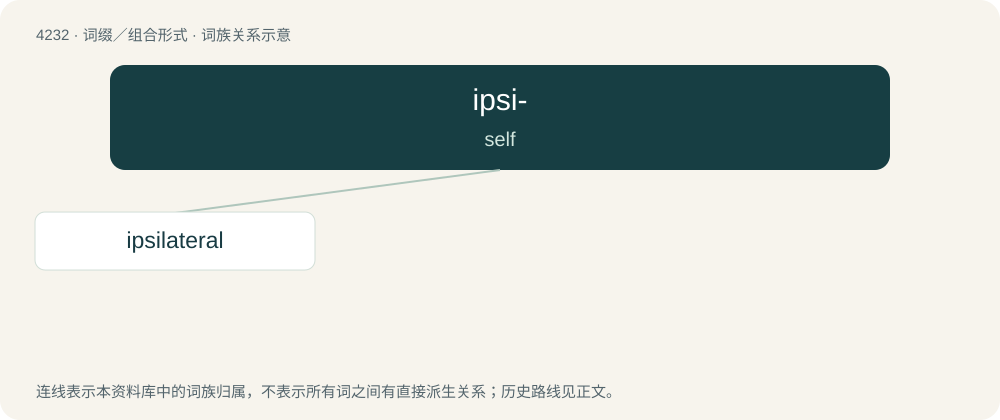

# 4239 · ipsi- — self

[总目录](../00_总目录_按常用程度.md)

**类型**：词缀／组合形式　｜　**来源语言**：见词源记录

## 核心含义与来源

- 核心含义：self
- 英文含义：self
- 词形：ipsi-

**来源记录 1**（前缀／前置成分；self）

By alteration of Latin ipse (“self”).

## 词族图

## 单词速览（常用到不常用）

| 单词 | 音标 | 释义 |
|---|---|---|
| [ipsilateral](#w-1) | /ˌɪpsɪˈlætəɹəl/ | \[医\] 同侧的 |

## 逐词详解

### 1. ipsilateral

**词性**：形容词　｜　**音标**：/ˌɪpsɪˈlætəɹəl/

**中文释义**：\[医\] 同侧的

**英文义项**：On the same side of the body.

**构词拆分**：From ipsi- + lateral.

**词源与演化**：

From ipsi- + lateral.

**例句**：

> The stroke was characterised by ipsilateral paralysis.

该用例对应义项：On the same side of the body.
