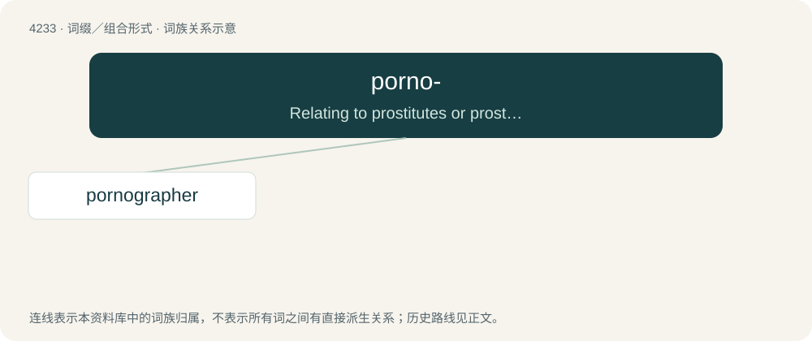

# 4240 · porno- — Relating to prostitutes or prostitution.

[总目录](../00_总目录_按常用程度.md)

**类型**：词缀／组合形式　｜　**来源语言**：见词源记录

## 核心含义与来源

- 核心含义：Relating to prostitutes or prostitution.
- 英文含义：Relating to prostitutes or prostitution.
- 词形：porno-

**来源记录 1**（前缀／前置成分；Relating to prostitutes or prostitution.）

From πορν- (porn-), the stem of the Ancient Greek πόρνη (pórnē, “prostitute”). Sense 2 from porno(graphy) and porno(grapher), both ultimately also from πόρνη (pórnē, “prostitute”).

## 词族图

## 单词速览（常用到不常用）

| 单词 | 音标 | 释义 |
|---|---|---|
| [pornographer](#w-1) | /pɔː(ɹ)ˈnɒɡɹəfə(ɹ)/ | n. 色情小说作家, 色情作品作者 |

## 逐词详解

### 1. pornographer

**词性**：名词　｜　**音标**：/pɔː(ɹ)ˈnɒɡɹəfə(ɹ)/

**中文释义**：n. 色情小说作家, 色情作品作者

**英文义项**：One who is involved in the creation or dissemination of pornography.

**构词拆分**：pornography + -er；porno- + -grapher

**词源与演化**：

From pornography + -er or porno- + -grapher.
