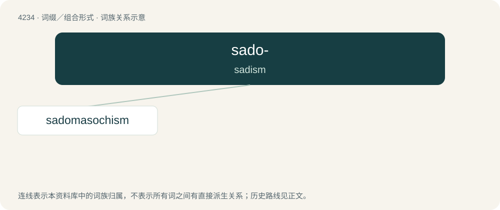

# 4241 · sado- — sadism

[总目录](../00_总目录_按常用程度.md)

**类型**：词缀／组合形式　｜　**来源语言**：见词源记录

## 核心含义与来源

- 核心含义：sadism
- 英文含义：sadism
- 词形：sado-

**来源记录 1**（前缀／前置成分；sadism）

From the name of the Marquis de Sade, initially used to form words like sadism and later extrapolated into a prefix.

## 词族图

## 单词速览（常用到不常用）

| 单词 | 音标 | 释义 |
|---|---|---|
| [sadomasochism](#w-1) | /seɪdəʊˈmæsəkɪzəm/ | n. 被虐待性变态 |

## 逐词详解

### 1. sadomasochism

**词性**：名词　｜　**音标**：/seɪdəʊˈmæsəkɪzəm/

**中文释义**：n. 被虐待性变态

**英文义项**：The practices of sadism and masochism collectively, usually in reference to consensual practices within the BDSM community. / Sadism and masochism: the (often sexual) enjoyment by one person of both inflicting and receiving pain.

**构词拆分**：sado- + masochism

**词源与演化**：

From sado- + masochism.
