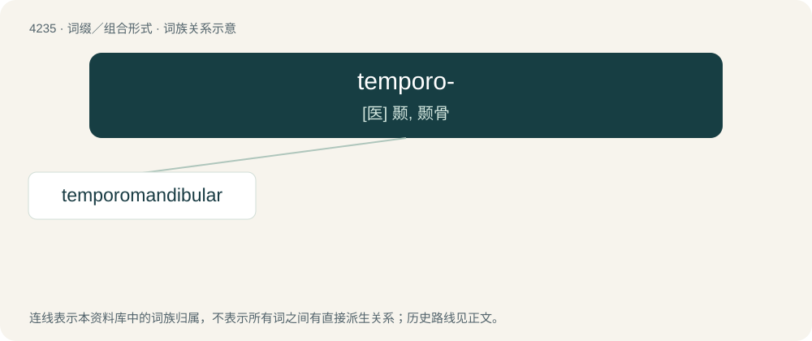

# 4242 · temporo- — \[医\] 颞, 颞骨

[总目录](../00_总目录_按常用程度.md)

**类型**：词缀／组合形式　｜　**来源语言**：见词源记录

## 核心含义与来源

- 核心含义：\[医\] 颞, 颞骨
- 英文含义：temporal: temples
- 词形：temporo-

**来源记录 1**（前缀／前置成分；temporal: temples）

Combining form of Latin tempora.

## 词族图

## 单词速览（常用到不常用）

| 单词 | 音标 | 释义 |
|---|---|---|
| [temporomandibular](#w-1) | /,tempərəjmænˈdibjjlə(r)/ | \[医\] 颞下颌的 |

## 逐词详解

### 1. temporomandibular

**词性**：形容词　｜　**音标**：/,tempərəjmænˈdibjjlə(r)/

**中文释义**：\[医\] 颞下颌的

**英文义项**：of or relating to both the temporal bone and mandible

**构词拆分**：temporo- + mandibular

**词源与演化**：

From temporo- + mandibular.
