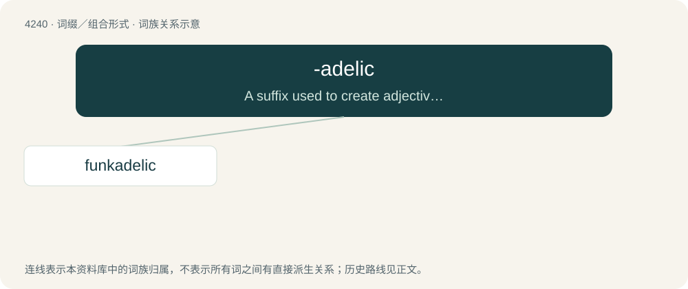

# 4246 · -adelic — A suffix used to create adjectives imparting a specific form of coolness, verve, or trippiness.

[总目录](../00_总目录_按常用程度.md)

**类型**：词缀／组合形式　｜　**来源语言**：见词源记录

## 核心含义与来源

- 核心含义：A suffix used to create adjectives imparting a specific form of coolness, verve, or trippiness.
- 英文含义：A suffix used to create adjectives imparting a specific form of coolness, verve, or trippiness.
- 词形：-adelic

**来源记录 1**（后缀／后置成分；A suffix used to create adjectives imparting a specific form of coolness, verve, or trippiness.）

From psychedelic.

## 词族图

## 单词速览（常用到不常用）

| 单词 | 音标 | 释义 |
|---|---|---|
| [funkadelic](#w-1) | /ˌfʌŋkəˈdɛlɪk/ | 【英文】Of, or relating to, funkadelia. |

## 逐词详解

### 1. funkadelic

**词性**：形容词　｜　**音标**：/ˌfʌŋkəˈdɛlɪk/

**英文义项**：Of, or relating to, funkadelia. / Having a funky beat.

**构词拆分**：funk + -adelic

**词源与演化**：

From funk + -adelic.
