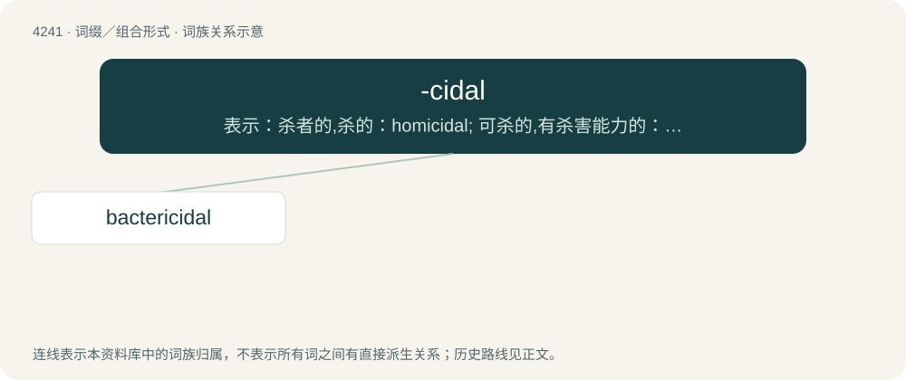

# 4247 · -cidal — 表示：杀者的,杀的：homicidal; 可杀的,有杀害能力的：fungicidal

[总目录](../00_总目录_按常用程度.md)

**类型**：词缀／组合形式　｜　**来源语言**：见词源记录

## 核心含义与来源

- 核心含义：表示：杀者的,杀的：homicidal; 可杀的,有杀害能力的：fungicidal
- 英文含义：Used to make adjectives corresponding to nouns ending in -cide.
- 词形：-cidal

**来源记录 1**（后缀／后置成分；Used to make adjectives corresponding to nouns ending in -cide.）

From -cide + -al.

## 词族图

## 单词速览（常用到不常用）

| 单词 | 音标 | 释义 |
|---|---|---|
| [bactericidal](#w-1) | /bæk.tiəriˈsaidl/ | a. 杀菌的；\[医\] 杀菌的 |

## 逐词详解

### 1. bactericidal

**词性**：形容词　｜　**音标**：/bæk.tiəriˈsaidl/

**中文释义**：a. 杀菌的；\[医\] 杀菌的

**英文义项**：That kills bacteria. / Of or pertaining to a bactericide.

**构词拆分**：bacterium + -cidal

**词源与演化**：

From bacteri(um) + -cidal.
