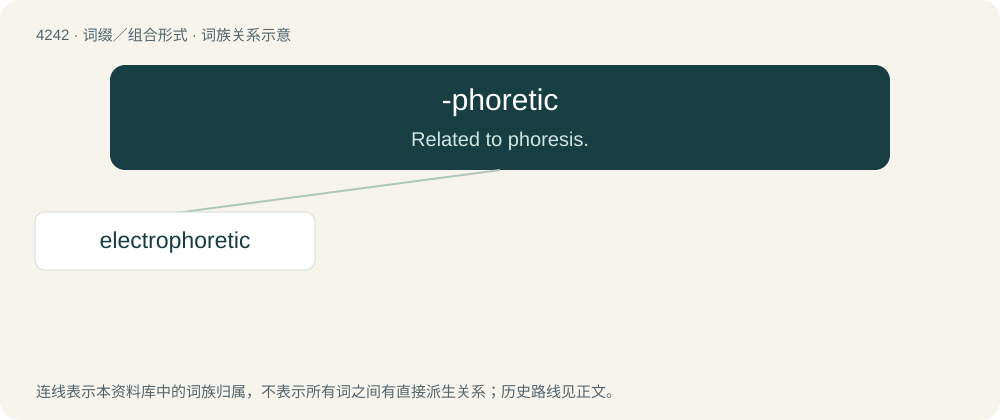

# 4248 · -phoretic — Related to phoresis.

[总目录](../00_总目录_按常用程度.md)

**类型**：词缀／组合形式　｜　**来源语言**：见词源记录

## 核心含义与来源

- 核心含义：Related to phoresis.
- 英文含义：Related to phoresis.
- 词形：-phoretic

**来源记录 1**（后缀／后置成分；Related to phoresis.）

From the adjective phoretic.

## 词族图

## 单词速览（常用到不常用）

| 单词 | 音标 | 释义 |
|---|---|---|
| [electrophoretic](#w-1) | /i,lektrəfəˈretik/ | a. \[物\]电泳的 |

## 逐词详解

### 1. electrophoretic

**词性**：形容词　｜　**音标**：/i,lektrəfəˈretik/

**中文释义**：a. \[物\]电泳的

**英文义项**：Of, pertaining to, or produced by electrophoresis.

**构词拆分**：electro- + -phoretic

**词源与演化**：

From electro- + -phoretic.
