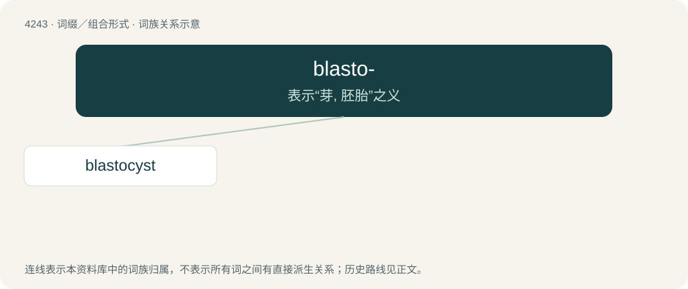

# 4249 · blasto- — 表示“芽, 胚胎”之义

[总目录](../00_总目录_按常用程度.md)

**类型**：词缀／组合形式　｜　**来源语言**：见词源记录

## 核心含义与来源

- 核心含义：表示“芽, 胚胎”之义
- 英文含义：bud; budding; germination
- 词形：blasto-

**来源记录 1**（前缀／前置成分；bud; budding; germination）

From Ancient Greek βλαστός (blastós, “a germ, bud, sprout, shoot”), from βλαστάνω (blastánō, “to bud, sprout, grow, properly of plants, but also of animals”).

## 词族图

## 单词速览（常用到不常用）

| 单词 | 音标 | 释义 |
|---|---|---|
| [blastocyst](#w-1) | /ˈblæstəsɪst/ | \[医\] 胚泡 |

## 逐词详解

### 1. blastocyst

**词性**：名词　｜　**音标**：/ˈblæstəsɪst/

**中文释义**：\[医\] 胚泡

**英文义项**：The mammalian blastula.

**构词拆分**：blasto- + cyst

**词源与演化**：

From blasto- + cyst.
