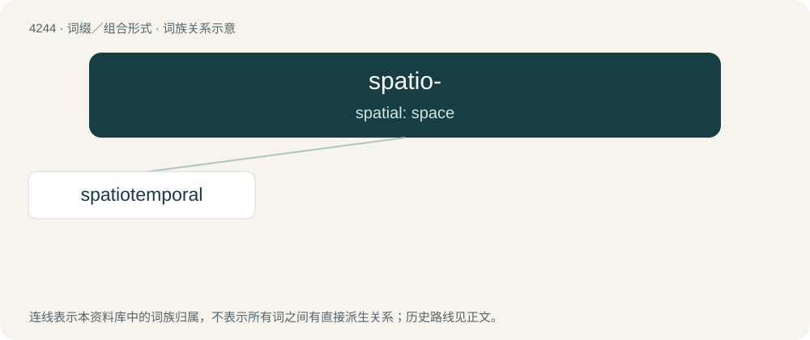

# 4250 · spatio- — spatial: space

[总目录](../00_总目录_按常用程度.md)

**类型**：词缀／组合形式　｜　**来源语言**：见词源记录

## 核心含义与来源

- 核心含义：spatial: space
- 英文含义：spatial: space
- 词形：spatio-

**来源记录 1**（前缀／前置成分；spatial: space）

From Latin spatium + English -o-.

## 词族图

## 单词速览（常用到不常用）

| 单词 | 音标 | 释义 |
|---|---|---|
| [spatiotemporal](#w-1) | /,speiʃiəuˈtempərəl/ | a. 空间与时间的, 时空的 |

## 逐词详解

### 1. spatiotemporal

**词性**：形容词　｜　**音标**：/,speiʃiəuˈtempərəl/

**中文释义**：a. 空间与时间的, 时空的

**英文义项**：Of, concerning, or existing in both space and time. / Of or concerning spacetime.

**构词拆分**：spatio- + temporal

**词源与演化**：

From spatio- + temporal.
