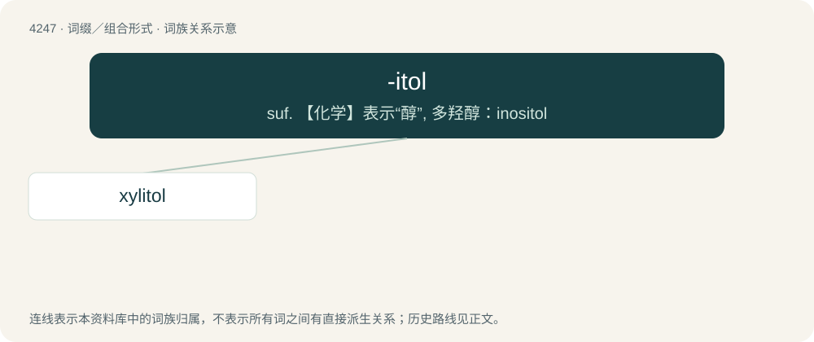

# 4254 · -itol — suf. 【化学】表示“醇”, 多羟醇：inositol

[总目录](../00_总目录_按常用程度.md)

**类型**：词缀／组合形式　｜　**来源语言**：见词源记录

## 核心含义与来源

- 核心含义：suf. 【化学】表示“醇”, 多羟醇：inositol
- 英文含义：Forming the names of polyhydric alcohols (sugar alcohols).
- 词形：-itol

**来源记录 1**（后缀／后置成分；Forming the names of polyhydric alcohols (sugar alcohols).）

From reanalysis of the ending of mannitol, sorbitol and so on, from -ite (an old, non-specific use of this suffix) + -ol.

## 词族图

## 单词速览（常用到不常用）

| 单词 | 音标 | 释义 |
|---|---|---|
| [xylitol](#w-1) | 英 /ˈzaɪlɪtɒl/；美 /ˈzaɪlɪtɑl/ | n. \[化\]木糖醇 |

## 逐词详解

### 1. xylitol

**词性**：名词　｜　**音标**：英 /ˈzaɪlɪtɒl/；美 /ˈzaɪlɪtɑl/

**中文释义**：n. \[化\]木糖醇

**英文义项**：A pentahydric alcohol, C₅H₁₂O₅, penta-hydroxy pentane; derived from xylose; used as a sweetener.

**词源与演化**：

From Ancient Greek ξύλον (xúlon, “wood”) + English -itol (“anhydric alcohol”).
