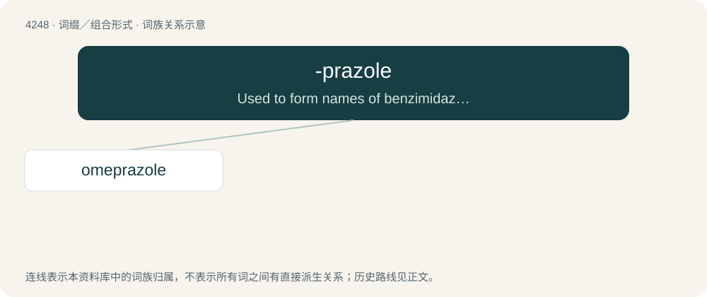

# 4255 · -prazole — Used to form names of benzimidazole derivatives used as antiulcers.

[总目录](../00_总目录_按常用程度.md)

**类型**：词缀／组合形式　｜　**来源语言**：见词源记录

## 核心含义与来源

- 核心含义：Used to form names of benzimidazole derivatives used as antiulcers.
- 英文含义：Used to form names of benzimidazole derivatives used as antiulcers.
- 词形：-prazole

**来源记录 1**（后缀／后置成分；Used to form names of benzimidazole derivatives used as antiulcers.）

From timoprazole.

## 词族图

## 单词速览（常用到不常用）

| 单词 | 音标 | 释义 |
|---|---|---|
| [omeprazole](#w-1) | 英 /əʊˈmɛp.ɹə.zəʊl/；美 /oʊˈmɛp.ɹəˌzoʊl/ | \[医\]奥美拉唑洛赛克, H2受体拮抗剂, 治疗消化道溃疡。 |

## 逐词详解

### 1. omeprazole

**词性**：名词　｜　**音标**：英 /əʊˈmɛp.ɹə.zəʊl/；美 /oʊˈmɛp.ɹəˌzoʊl/

**中文释义**：\[医\]奥美拉唑洛赛克, H2受体拮抗剂, 治疗消化道溃疡。

**英文义项**：A substituted benzimidazole (trademark Losec, Prilosec) which is a proton pump inhibitor and inhibits secretion of gastric acid, being given orally in the treatment of ulcers and gastroesophageal reflux; 5-methoxy-2-(4-methoxy-3,5-dimethyl-2-pyridylmethylsulfinyl)benzimidazole, C₁₇H₁₉N₃O₃S.

**构词拆分**：oxy- + metho- + -prazole

**词源与演化**：

From o(xy)- + me(tho)- + -prazole (“benzimidazole derivative”).
