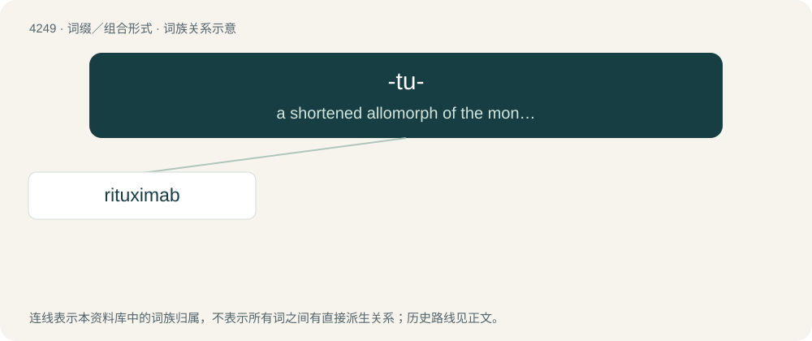

# 4256 · -tu- — a shortened allomorph of the monoclonal antibody affix -tum-, used before the affixes -xi- and -zu- for ease of pronunciation

[总目录](../00_总目录_按常用程度.md)

**类型**：词缀／组合形式　｜　**来源语言**：见词源记录

## 核心含义与来源

- 核心含义：a shortened allomorph of the monoclonal antibody affix -tum-, used before the affixes -xi- and -zu- for ease of pronunciation
- 英文含义：a shortened allomorph of the monoclonal antibody affix -tum-, used before the affixes -xi- and -zu- for ease of pronunciation
- 词形：-tu-

## 词族图

## 单词速览（常用到不常用）

| 单词 | 音标 | 释义 |
|---|---|---|
| [rituximab](#w-1) | 美 /ɹɪˈtʌk.sɪˌmæb/ | \[医\]利妥昔单抗&lt;抗肿瘤药&gt; |

## 逐词详解

### 1. rituximab

**词性**：名词　｜　**音标**：美 /ɹɪˈtʌk.sɪˌmæb/

**中文释义**：\[医\]利妥昔单抗&lt;抗肿瘤药&gt;

**英文义项**：A chimeric monoclonal antibody (trademark Rituxan) administered by intravenous injection especially to treat non-Hodgkin lymphoma and chronic lymphocytic leukemia by binding to the protein CD20 found on the surface of B cells and causing their lysis.

**构词拆分**：\[Term?\] + -tu- (“tumor”) + -ximab (“chimeric monoclonal antibody”)

**词源与演化**：

From \[Term?\] + -tu- (“tumor”) + -ximab (“chimeric monoclonal antibody”).
