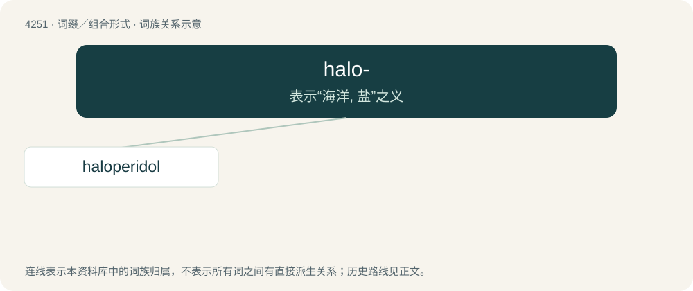

# 4258 · halo- — 表示“海洋, 盐”之义

[总目录](../00_总目录_按常用程度.md)

**类型**：词缀／组合形式　｜　**来源语言**：见词源记录

## 核心含义与来源

- 核心含义：表示“海洋, 盐”之义
- 英文含义：sea, salt, salt water
- 词形：halo-

**来源记录 1**（前缀／前置成分；Forming names of chemical compounds which contain one or more halogen atoms.）

From halogen.

## 词族图

## 单词速览（常用到不常用）

| 单词 | 音标 | 释义 |
|---|---|---|
| [haloperidol](#w-1) | 英 /ˌhæ.lə(ʊ)ˈpɛ.ɹɪ.dɒl/；美 /ˌhæ.loʊˈpɛ.ɹɪˌdɔl/ | \[化\] 氟哌啶醇; 氟哌丁苯 |

## 逐词详解

### 1. haloperidol

**词性**：名词　｜　**音标**：英 /ˌhæ.lə(ʊ)ˈpɛ.ɹɪ.dɒl/；美 /ˌhæ.loʊˈpɛ.ɹɪˌdɔl/

**中文释义**：\[化\] 氟哌啶醇; 氟哌丁苯

**英文义项**：A synthetic antidepressant drug, with the chemical formula C₂₁H₂₃ClFNO₂, used in the treatment of psychotic conditions.

**构词拆分**：halo- + (pi)perid(ine) + -ol

**词源与演化**：

From halo- + (pi)perid(ine) + -ol. By surface analysis, halo- + -peridol.

**例句**：

> Dr. Jackson gave Tom some haloperidol.
