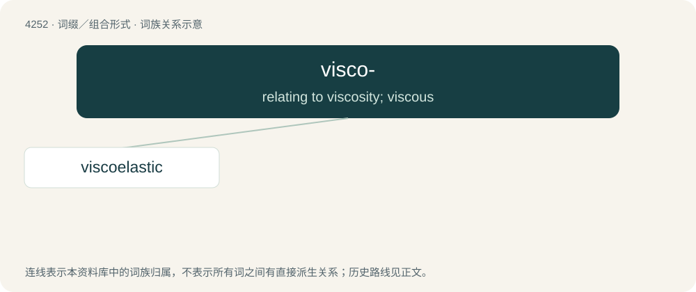

# 4259 · visco- — relating to viscosity; viscous

[总目录](../00_总目录_按常用程度.md)

**类型**：词缀／组合形式　｜　**来源语言**：见词源记录

## 核心含义与来源

- 核心含义：relating to viscosity; viscous
- 英文含义：relating to viscosity; viscous
- 词形：visco-

## 词族图

## 单词速览（常用到不常用）

| 单词 | 音标 | 释义 |
|---|---|---|
| [viscoelastic](#w-1) | /,viskəuiˈlæstik/ | a. 粘弹性的 |

## 逐词详解

### 1. viscoelastic

**词性**：形容词　｜　**音标**：/,viskəuiˈlæstik/

**中文释义**：a. 粘弹性的

**英文义项**：Viscous and elastic.

**构词拆分**：visco- + elastic

**词源与演化**：

From visco- + elastic.
