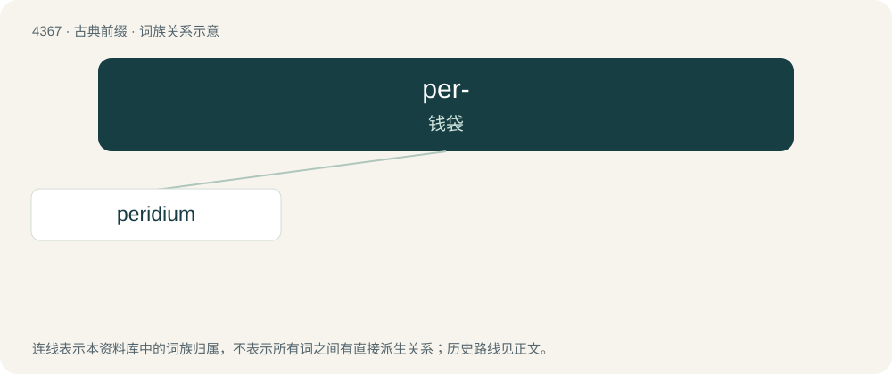

# 4367 · per- — 钱袋

[总目录](../00_总目录_按常用程度.md)

**类型**：古典前缀　｜　**来源语言**：古希腊语

## 核心含义与来源

- 核心含义：钱袋
- 英文含义：wallet
- 词形：per-

**来源词形**：πήρα (pḗra), πηρίδιον (pērídion)

## 词族图

## 单词速览（常用到不常用）

| 单词 | 音标 | 释义 |
|---|---|---|
| [peridium](#w-1) | /pəˈridiəm/ | n. \[植\]( 某些真菌的) 包被 |

## 逐词详解

### 1. peridium

**词性**：名词　｜　**音标**：/pəˈridiəm/

**中文释义**：n. \[植\]( 某些真菌的) 包被

**英文义项**：The outer layer that covers the spore-bearing organ in many fungi.

**词源与演化**：

A New Latin form of Ancient Greek πηρίδιον (pērídion, “little pouch”).
