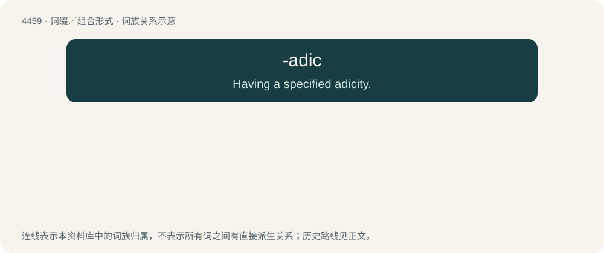

# 4458 · -adic — Having a specified adicity.

[总目录](../00_总目录_按常用程度.md)

**类型**：词缀／组合形式　｜　**来源语言**：见词源记录

## 核心含义与来源

- 核心含义：Having a specified adicity.
- 英文含义：Having a specified adicity.
- 词形：-adic

**来源记录 1**（后缀／后置成分；Having a specified adicity.）

Back-formation from monadic, etc., from Ancient Greek -άς (-ás) (genitive -άδος (-ádos)) + -ικός (-ikós) (English -ad + -ic). Compare related adicity and Latinate -ary. The algebraic sense is by analogy with p-adic, since ℤ₍ₚ₎ equipped with the (p)-adic topology passes to the ring of p-adic numbers under the operation of completion.

## 词族图

