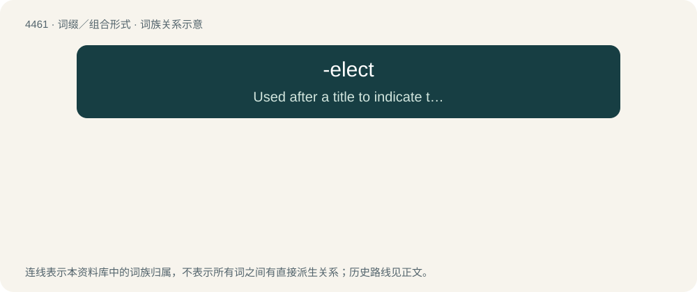

# 4460 · -elect — Used after a title to indicate that the person has been elected to hold the title, but has not yet officially taken it.

[总目录](../00_总目录_按常用程度.md)

**类型**：词缀／组合形式　｜　**来源语言**：见词源记录

## 核心含义与来源

- 核心含义：Used after a title to indicate that the person has been elected to hold the title, but has not yet officially taken it.
- 英文含义：Used after a title to indicate that the person has been elected to hold the title, but has not yet officially taken it.
- 词形：-elect

**来源记录 1**（后缀／后置成分；Used after a title to indicate that the person has been elected to hold the title, but has not yet officially taken it.）

From elect.

## 词族图

