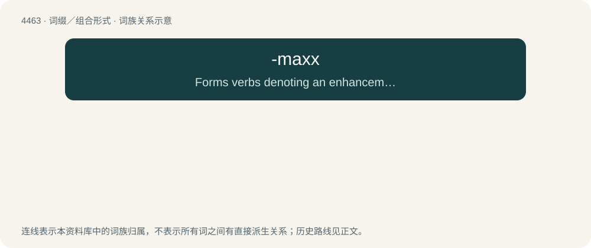

# 4462 · -maxx — Forms verbs denoting an enhancement or improvement, with the goal of "maximizing" one's attractiveness, appeal, or sexual market value.

[总目录](../00_总目录_按常用程度.md)

**类型**：词缀／组合形式　｜　**来源语言**：见词源记录

## 核心含义与来源

- 核心含义：Forms verbs denoting an enhancement or improvement, with the goal of "maximizing" one's attractiveness, appeal, or sexual market value.
- 英文含义：Forms verbs denoting an enhancement or improvement, with the goal of "maximizing" one's attractiveness, appeal, or sexual market value.
- 词形：-maxx

**来源记录 1**（后缀／后置成分；Forms verbs denoting an enhancement or improvement, with the goal of "maximizing" one's attractiveness, appeal, or sexual market value.）

Clipping of maximize, with a superfluous x presumably to mimic Internet slang. Compare doxx.

## 词族图

