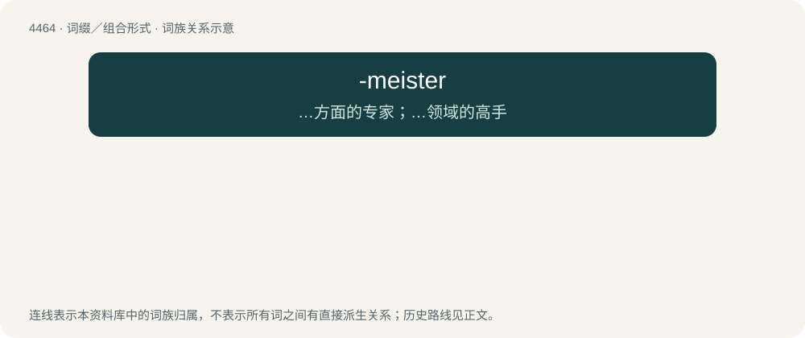

# 4463 · -meister — …方面的专家；…领域的高手

[总目录](../00_总目录_按常用程度.md)

**类型**：词缀／组合形式　｜　**来源语言**：见词源记录

## 核心含义与来源

- 核心含义：…方面的专家；…领域的高手
- 英文含义：An expert on the specified subject.
- 词形：-meister

**来源记录 1**（后缀／后置成分；An expert on the specified subject.）

From meister, from German Meister (“master”, “champion”).

## 词族图

