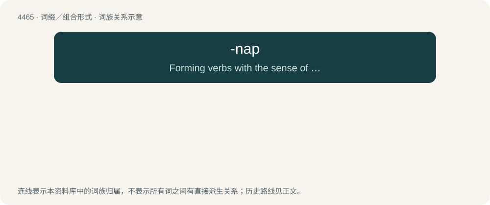

# 4464 · -nap — Forming verbs with the sense of "abduct", or sometimes "abscond with".

[总目录](../00_总目录_按常用程度.md)

**类型**：词缀／组合形式　｜　**来源语言**：见词源记录

## 核心含义与来源

- 核心含义：Forming verbs with the sense of "abduct", or sometimes "abscond with".
- 英文含义：Forming verbs with the sense of "abduct", or sometimes "abscond with".
- 词形：-nap

**来源记录 1**（后缀／后置成分；Forming verbs with the sense of "abduct", or sometimes "abscond with".）

Apparently a back-formation from kidnap (see libfix); ultimately from nap.

## 词族图

