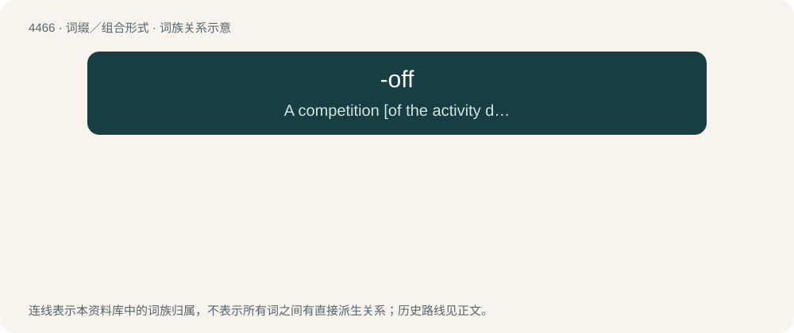

# 4465 · -off — A competition \[of the activity denoted by the word it combines with\], especially a final, tiebreaker, or repechage within a broader tournament.

[总目录](../00_总目录_按常用程度.md)

**类型**：词缀／组合形式　｜　**来源语言**：见词源记录

## 核心含义与来源

- 核心含义：A competition \[of the activity denoted by the word it combines with\], especially a final, tiebreaker, or repechage within a broader tournament.
- 英文含义：A competition \[of the activity denoted by the word it combines with\], especially a final, tiebreaker, or repechage within a broader tournament.
- 词形：-off

**来源记录 1**（后缀／后置成分；A competition \[of the activity denoted by the word it combines with\], especially a final, tiebreaker, or repechage within a broader tournament.）

Back-formation from playoff, a deverbal, as the archetype.

## 词族图

