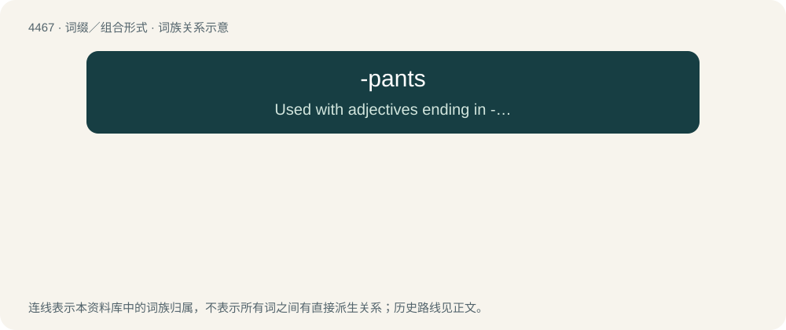

# 4466 · -pants — Used with adjectives ending in -y to form nicknames based on a negative quality of a person.

[总目录](../00_总目录_按常用程度.md)

**类型**：词缀／组合形式　｜　**来源语言**：见词源记录

## 核心含义与来源

- 核心含义：Used with adjectives ending in -y to form nicknames based on a negative quality of a person.
- 英文含义：Used with adjectives ending in -y to form nicknames based on a negative quality of a person.
- 词形：-pants

**来源记录 1**（后缀／后置成分；Used with adjectives ending in -y to form nicknames based on a negative quality of a person.）

Extracted from fancypants.

## 词族图

