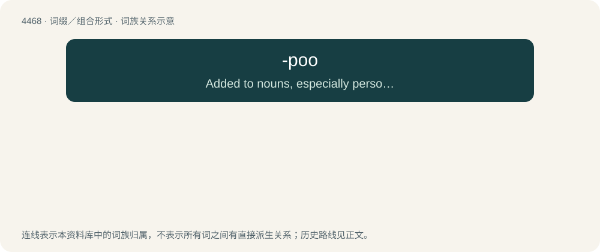

# 4467 · -poo — Added to nouns, especially personal names, ending in -y or -ie, or with this sound inserted, to form affectionate, playful diminutives.

[总目录](../00_总目录_按常用程度.md)

**类型**：词缀／组合形式　｜　**来源语言**：见词源记录

## 核心含义与来源

- 核心含义：Added to nouns, especially personal names, ending in -y or -ie, or with this sound inserted, to form affectionate, playful diminutives.
- 英文含义：Added to nouns, especially personal names, ending in -y or -ie, or with this sound inserted, to form affectionate, playful diminutives.
- 词形：-poo

**多个词源／构词路径**：同一拼写可能有不同来源；以下按词性和含义分别列出。

**来源记录 1**（后缀／后置成分；Added to nouns, especially personal names, ending in -y or -ie, or with this sound inserted, to form affectionate, playful diminutives.）

Unknown, probably arbitrary or from poo.

**来源记录 2**（后缀／后置成分；Used for constructing a breed name of designer dogs one of whose parents is a poodle.）

Clipping of poodle.

## 词族图

