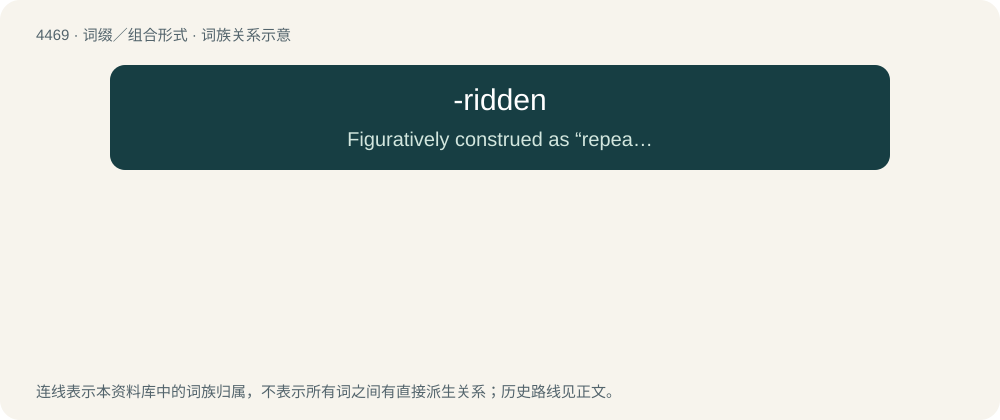

# 4468 · -ridden — Figuratively construed as “repeatedly/perennially affected by” or “unable to escape from”.

[总目录](../00_总目录_按常用程度.md)

**类型**：词缀／组合形式　｜　**来源语言**：见词源记录

## 核心含义与来源

- 核心含义：Figuratively construed as “repeatedly/perennially affected by” or “unable to escape from”.
- 英文含义：Figuratively construed as “repeatedly/perennially affected by” or “unable to escape from”.
- 词形：-ridden

**来源记录 1**（后缀／后置成分；Figuratively construed as “repeatedly/perennially affected by” or “unable to escape from”.）

Back-formation from bedridden.

## 词族图

