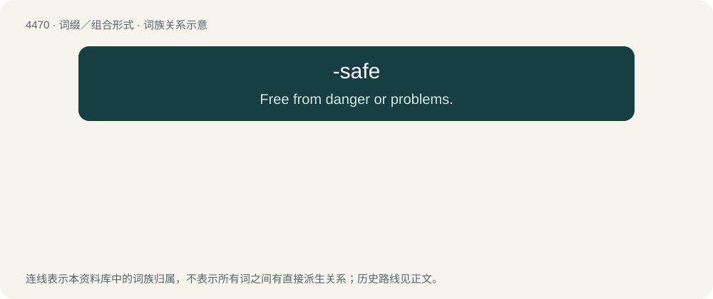

# 4469 · -safe — Free from danger or problems.

[总目录](../00_总目录_按常用程度.md)

**类型**：词缀／组合形式　｜　**来源语言**：见词源记录

## 核心含义与来源

- 核心含义：Free from danger or problems.
- 英文含义：Free from danger or problems.
- 词形：-safe

## 词族图

