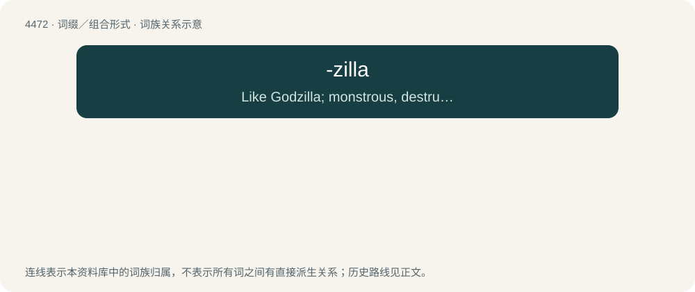

# 4471 · -zilla — Like Godzilla; monstrous, destructive, massive, powerful, wild.

[总目录](../00_总目录_按常用程度.md)

**类型**：词缀／组合形式　｜　**来源语言**：见词源记录

## 核心含义与来源

- 核心含义：Like Godzilla; monstrous, destructive, massive, powerful, wild.
- 英文含义：Like Godzilla; monstrous, destructive, massive, powerful, wild.
- 词形：-zilla

**来源记录 1**（后缀／后置成分；Like Godzilla; monstrous, destructive, massive, powerful, wild.）

Rebracketing of Godzilla.

## 词族图

