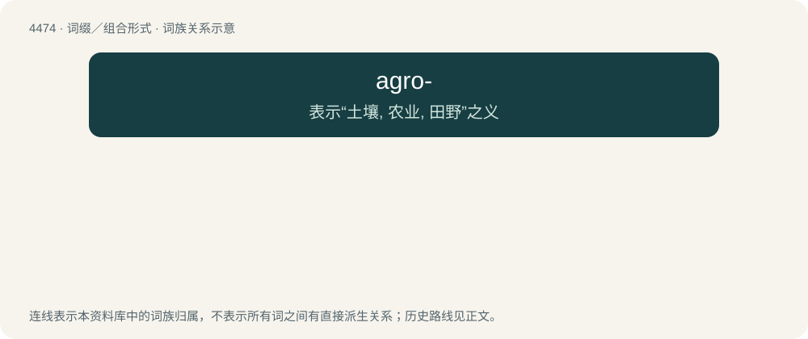

# 4473 · agro- — 表示“土壤, 农业, 田野”之义

[总目录](../00_总目录_按常用程度.md)

**类型**：词缀／组合形式　｜　**来源语言**：见词源记录

## 核心含义与来源

- 核心含义：表示“土壤, 农业, 田野”之义
- 英文含义：agriculture
- 词形：agro-

**来源记录 1**（前缀／前置成分；agriculture）

Ultimately from Latin ager.

## 词族图

