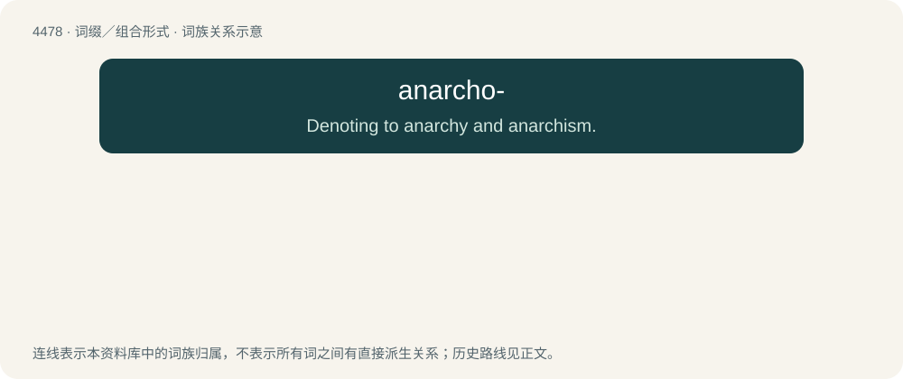

# 4477 · anarcho- — Denoting to anarchy and anarchism.

[总目录](../00_总目录_按常用程度.md)

**类型**：词缀／组合形式　｜　**来源语言**：见词源记录

## 核心含义与来源

- 核心含义：Denoting to anarchy and anarchism.
- 英文含义：Denoting to anarchy and anarchism.
- 词形：anarcho-

## 词族图

