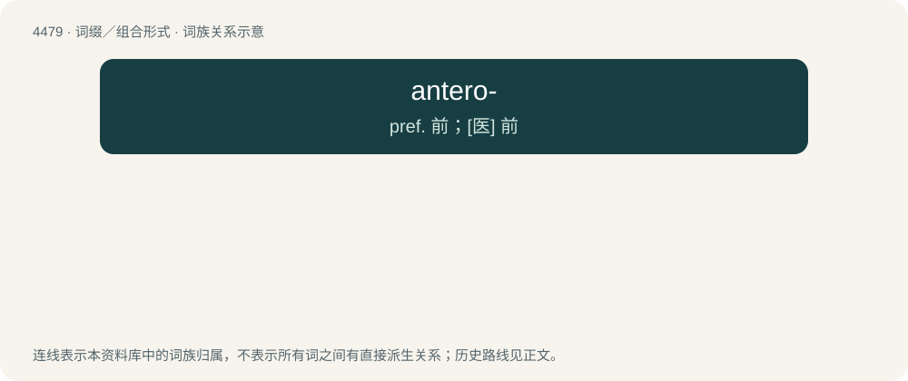

# 4478 · antero- — pref. 前；\[医\] 前

[总目录](../00_总目录_按常用程度.md)

**类型**：词缀／组合形式　｜　**来源语言**：见词源记录

## 核心含义与来源

- 核心含义：pref. 前；\[医\] 前
- 英文含义：anterior; front; forward
- 词形：antero-

**来源记录 1**（前缀／前置成分；anterior; front; forward）

From international scientific vocabulary, reflecting a New Latin combining form, from Latin anterior.

## 词族图

