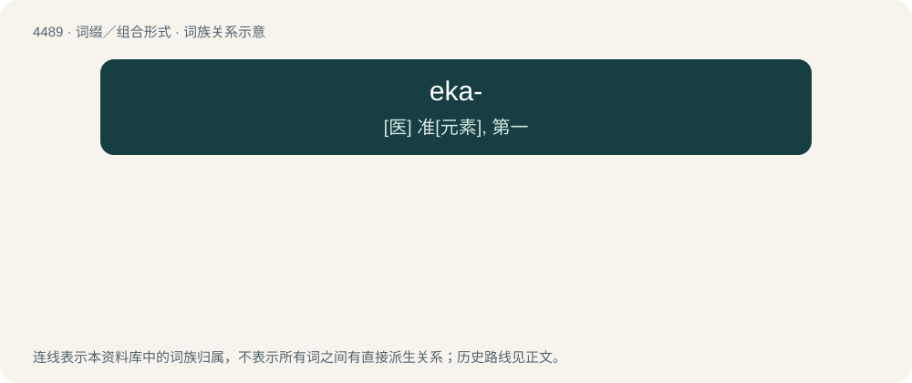

# 4489 · eka- — \[医\] 准\[元素\], 第一

[总目录](../00_总目录_按常用程度.md)

**类型**：词缀／组合形式　｜　**来源语言**：见词源记录

## 核心含义与来源

- 核心含义：\[医\] 准\[元素\], 第一
- 英文含义：Used to form prototype names for as-yet undiscovered elements, when prepended to the known element above them in the same group of the periodic table.
- 词形：eka-

**来源记录 1**（前缀／前置成分；Used to form prototype names for as-yet undiscovered elements, when prepended to the known element above them in the same group of the periodic table.）

Borrowed from Sanskrit एक (eka, “one, first”).

## 词族图

