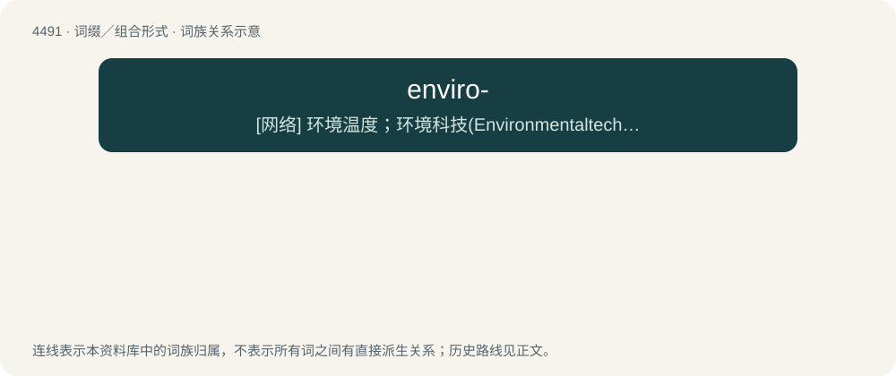

# 4491 · enviro- — \[网络\] 环境温度；环境科技(Environmentaltechnology)；环保标志

[总目录](../00_总目录_按常用程度.md)

**类型**：词缀／组合形式　｜　**来源语言**：见词源记录

## 核心含义与来源

- 核心含义：\[网络\] 环境温度；环境科技(Environmentaltechnology)；环保标志
- 英文含义：environmental or environmentalist.
- 词形：enviro-

**来源记录 1**（前缀／前置成分；environmental or environmentalist.）

Shortened form of environment. Compare enviro-friendly.

## 词族图

